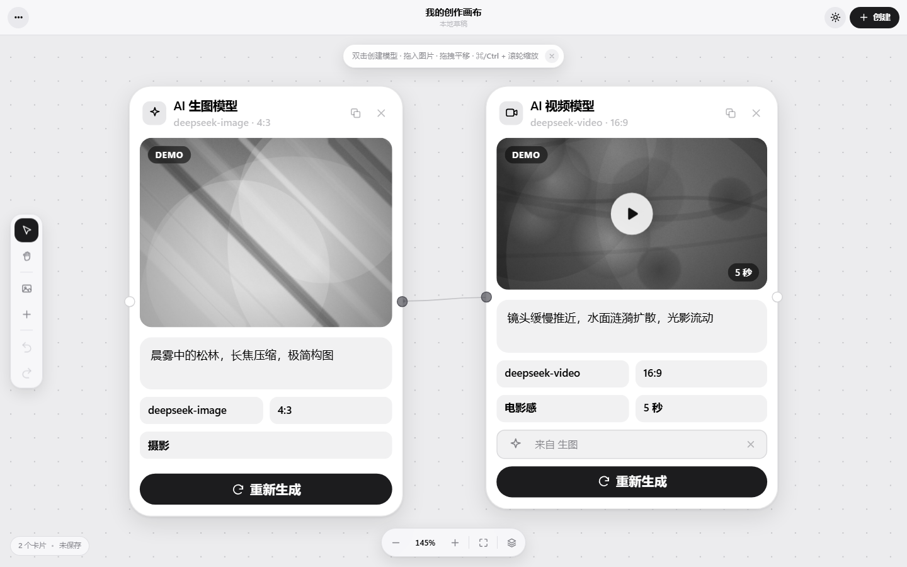
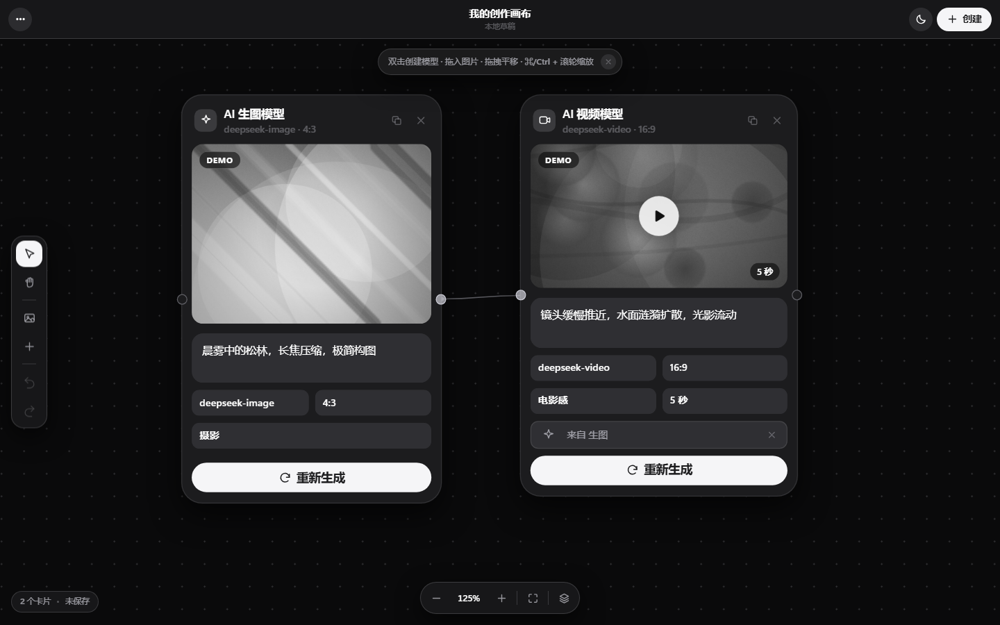
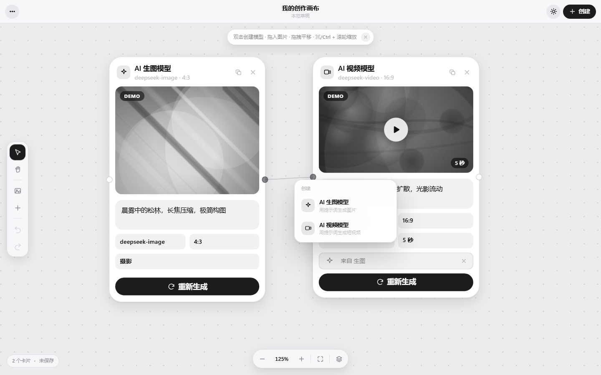
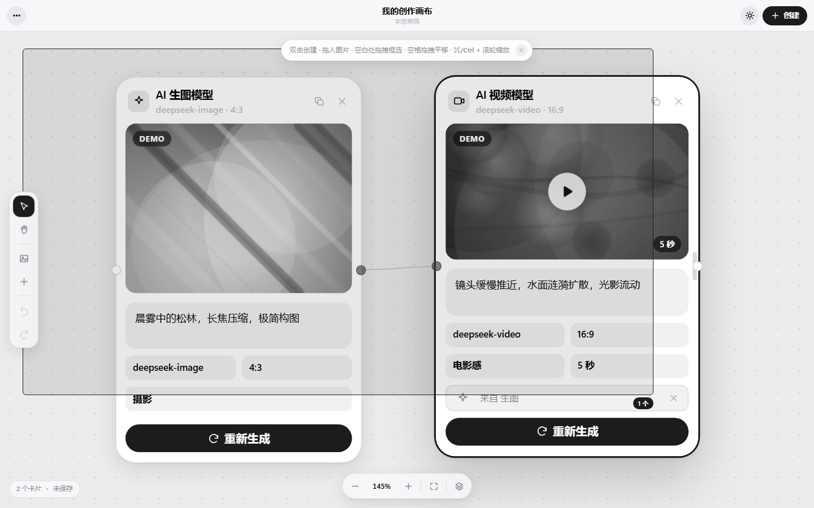

# AI Canvas · 自由创作画布

一个 AI 创作画布：**拖进图片 → 连线 → 写提示词 → 出图/出视频**。

iOS / Apple 设计语言，纯黑白灰配色，浅色与深色双主题。

> 这不是 ComfyUI 那种「必须先连好才能跑」的节点图。卡片想放哪放哪，连线只表示「这两张有关系」，不强制顺序、也不构成流程。

## 预览





<table>
<tr>
<td width="50%">

**双击空白处创建卡片**



</td>
<td width="50%">

**拖拽框选多张**



</td>
</tr>
</table>

## 技术栈一览

```
前端   原生 JavaScript（无框架）+ CSS + SVG          ~6,000 行
       零构建、零依赖 —— 没有 npm / webpack / node_modules
       双击 index.html 就能跑

后端   Python 3 标准库 + oss2                        ~1,200 行
       单一职责的四个模块：转发 / 校验 / 限流 / 路由

云端   阿里云 OSS（图片永久存储）
       Grsai 中转站（生图 + 短视频）
       速创 Wan3.0（长视频，已接入）

AI     多模型接入层：统一入口，屏蔽两家接口的差异
```

**两个刻意的设计取舍**（展开在下面）：

1. **前端不用框架** —— 无限画布的拖拽场景，虚拟 DOM 反而是负担
2. **密钥不进浏览器** —— 所有需要密钥的调用走后端，见 [安全设计](#-安全设计密钥不进浏览器)

## 怎么跑起来

```bash
# 方式一：双击 start.bat（会起服务 + 开浏览器）

# 方式二：手动
python server.py 8777          # 前端，http://127.0.0.1:8777
python upload_server.py 8778   # 后端（密钥、OSS、限流都在这）
```

第一次跑需要先建配置文件：

```bash
cp config.example.js config.local.js
# 然后填上你的密钥（这个文件在 .gitignore 里，不会被提交）
```

部署到公网见 **[DEPLOY.md](DEPLOY.md)**。

---

## 怎么用

| 操作 | 方式 |
|---|---|
| **新建模型** | **双击画布空白处** → 弹出「AI 生图模型 / AI 视频模型」 |
| **拖入图片** | 把电脑里的图片直接**拖到画布上**（可多选，支持 ⌘V 粘贴） |
| **移动卡片** | **整张卡片任意位置都能拖**（顶栏、预览区、表单空白处都行）；输入框 / 下拉 / 按钮上按住则不移动，正常操作控件 |
| **改宽度** | 悬停卡片时右侧出现把手，左右拖 |
| **写提示词** | 直接在卡片里的输入框写，点「生成图片 / 生成视频」 |
| **拉连线** | 按住卡片边缘的**小圆点**拖到另一张卡，松开即连上（图片卡右侧只有输出，模型卡左右都有） |
| **删连线** | 点一下线选中，再按 `Delete`；或点线中间的圆形 × |
| **当参考图** | 把图片直接拖到模型卡上，松开即连成输入（等价于拉一条线） |
| **改角色** | 输入条上点角色标签循环切换：参考 → 主体 → 风格 → 首帧 → 尾帧 |
| **在提示词里 @** | 输入框里打 `@` 弹出候选（只列连进来的图），↑↓ 选、回车确认；例如「@雪山清晨 的色调，@人物特写 作为主体」 |
| **框选** | **空白处按住拖拽**即可拉出选择矩形（跟随鼠标，右下角实时显示选中数量）；按住 `Shift`/`⌘` 拖拽 = 追加到已有选择 |
| **平移 / 缩放** | **空格 + 拖拽** / 中键拖拽 / 切到平移工具 · `⌘/Ctrl + 滚轮` 或触控板捏合缩放 · 双指滚动平移 |
| **复制 / 粘贴** | `⌘C` 复制 · `⌘X` 剪切 · `⌘V` 粘贴到**当前鼠标位置**（整组左上角对齐鼠标、往下 8px；卡片之间的相对位置保持不变）。鼠标不动连按 ⌘V 会依次错开 34px |
| **其它** | `⌘Z` 撤销 · `⇧⌘Z` 重做 · `⌘D` 原地复制 · `⌘A` 全选 · `Delete` 删除 · `⌘0` 适应视图 · `Esc` 取消选择 |

---

## 三种卡片

**AI 生图模型** — 提示词 + 模型 + 比例 + 风格，生成结果直接落在卡片里。

**AI 视频模型** — 多一个时长选项，结果带播放按钮和时长角标。

**图片素材** — 拖进来的本地图片，自动等比缩放到最长边 1600px 再存，卡片显示原图尺寸。

卡片宽度可调（160–720px），高度由内容自动决定，所以改比例、改宽度都不会变形。

---

## 连线是怎么工作的（轻量连接）

卡片边缘的小圆点就是端口：**模型卡左边是输入、右边是输出**，**图片素材只有右边（输出）**。从圆点拖一条线到另一张卡就建立了连接。

连线的含义很直接 —— **把上游的输出喂给下游当输入**：

- **图片 → 模型卡**：这张图作为该模型卡的参考图（图生图 / 视频首帧）
- **模型卡 → 模型卡**：上游生成的结果作为下游的输入（例如先生图、再拿这张图去生成视频）

连接后会怎样：
- 卡片里出现一行「来自 XX」的输入条，点它的 × 可以单独断开
- 重新生成时，参考图会一起提交给后端（`refImage` 字段）
- 输入变了，生成结果的 seed 也会变（同一个提示词 + 同一组输入 = 同一张图）

约束（避免连出无意义的结构）：不能自己连自己、不能重复连、图片素材不能接收输入。删除卡片时相关连线会自动一起删掉。

画布本身仍然是自由摆放的 —— 连线只是"这两张卡有关系"的记号，不强制顺序，也没有节点图那种必须先摆好再跑的结构。


## 在提示词里 @ 图片（全能参考）

连进卡片的图会得到一个**短名**（取图片名，重名自动加序号）：`风景.png` → `@风景`。

在提示词框里打 `@`，会弹出候选列表（**只列已经连到这张卡的图**）：

- `↑` `↓` 选择，`回车` / `Tab` 确认，`Esc` 取消
- 也可以鼠标点选
- 确认后会插入 `@短名 `，光标停在后面

**每张图还有个「角色」**，点输入条上的角色标签循环切换：

| 角色 | 意思 |
|---|---|
| 参考 | 当作一般参考图 |
| 主体 | 保持这张图里的主体 / 人物一致 |
| 风格 | 沿用这张图的画风 / 色调 |
| 首帧 | 视频从这里开始 |
| 尾帧 | 视频到这里结束 |

**不 @ 也不会丢图**：

- 一条都没 @ → 连进来的图**全部**当普通参考（和以前行为一致）
- @ 了某几张 → 只传被 @ 的那些
- @ 了一个不存在的名字 → 退回「全部当参考」

这些信息和角色会一起提交给后端（`refs` 数组）。**具体怎么发给中转站**（base64 / URL / file_id）在 `api.js` 里做映射 —— 那是接接口时要填的部分。

## 演示模式（`USE_MOCK`）

`api.js` 里有个 `USE_MOCK` 开关，默认 `true` 时**完全不联网** ——
按提示词算出一个 seed，用 `art.js` 程序化画一张黑白抽象图。

**这是刻意保留的**，不是没做完：

- **没配密钥也能跑起来**。克隆下来直接双击就能看到完整交互（拖拽、连线、撤销、历史），
  不用先去注册一个中转站账号。降低试用的门槛。
- **测试画布逻辑时不花钱**。画布本身的交互逻辑和 AI 无关，用假数据测更快更省。
- **结果是确定性的**：同一个 seed 永远画出同一张图。所以文档里只存 `seed`（几十字节），
  重新打开再画一遍即可 —— 生成 100 张图也不会撑爆 localStorage。
- **结果角上有 `DEMO` 角标**，提醒这是占位内容；配好密钥后角标自动消失。

接真实接口：把 `config.local.js` 里的 `USE_MOCK` 改成 `false`。

---

## 接入真实 API（已接 Grsai 中转站）

所有网络访问都收在 `assets/js/api.js`，而它**只对自己的后端说话**。

### 配置放哪：config.local.js

密钥**不要**写进 `api.js`（那个文件会提交到 GitHub）。复制模板：

```
config.example.js   →  复制成  config.local.js
```

然后填 `config.local.js`：

```js
window.FC.LOCAL = {
  USE_MOCK: false,
  BASE_URL: 'https://grsai.dakka.com.cn',   // 国内直连；国外用 https://grsaiapi.com
  API_KEY: 'sk-你的密钥',                    // https://grsai.ai/zh/dashboard/api-keys
  IMAGE_MODE: 'base64',
  MODELS: { image: 'gpt-image-2', video: 'minimax-h3' }
};
```

`config.local.js` 已在 `.gitignore` 里，**不会上传**。

### Grsai 接口长什么样

```
提交:  POST {BASE_URL}/v1/api/generate
查询:  GET  {BASE_URL}/v1/api/result?id={id}
认证:  Authorization: Bearer sk-xxx

返回:  { id, status, progress, results:[{url}], error }
状态:  running 进行中 / succeeded 成功 / violation 违规 / failed 失败
```

**用 `replyType: "async"` 而不是 `"json"`**：只有 async 会返回 `progress`，卡片上的进度条能直接用；而且长任务不会把 HTTP 请求拖到超时。

生图的参考图放在 `images` 数组里，文档明确写了「**支持 base64 与 url 链接**」，两种都行。

### 模型与参数的坑

| | 生图 | 视频 |
|---|---|---|
| 模型 | `gpt-image-2` `gpt-image-2.5` `gpt-image-2-vip` `nano-banana-2` … | `minimax-h3` |
| 比例 | `auto` / `1:1` / `16:9` … 或像素值 `1024x1024` | **只认 `landscape` / `portrait`** |
| 质量 | gpt-image-2 与 2.5 **只有 `auto`** | — |
| 其他 | 2.5 不支持 `background` / `mask`（vip / flare / sunburst 才有） | `resolution` 480p/768p/1080p；`duration` 整数 1~15；1080p 最多 10 秒 |

比例写法在 `api.js` 的 `normalizeRatio()` 里统一转换 —— 界面上你看到的是 `16:9`，发出去会自动变成 `landscape`。

### 实测数据（2026-10）

| 模型 | 结果 | 耗时 | 价格 |
|---|---|---|---|
| `gpt-image-2` | ✅ | ~33 秒 | ¥0.03/次 |
| `gpt-image-2.5` | ✅ | ~4 分钟（明显更慢） | ¥0.03/次 |

**日常用 `gpt-image-2`**，2.5 慢很多但价格一样。

### 中转站的几个已知问题（不是我们的 bug）

1. **图床不稳定 / 图片会过期**：Grsai 返回的图存在它的图床（`fileN.aitohumanize.com`）。实测这些图**过几个钟头就 404 了**，而且部分节点（如 `file2`）证书有问题 / 连不上。所以：
   - **生成结果会自动转存到你自己 OSS**（见下面「自动转存」一节），转存后永久有效
   - 卡片上有角标：☁ = 已存云端（永久），🕐 = 还在中转站（会过期）
2. **它的文件服务器不支持 HEAD 请求**：
   ```
   GET  https://file6.aitohumanize.com/file/xxx.mp4  ->  200  2,140,686 B
   HEAD 同一个地址                                    ->  404
   ```
   刚生成的视频用 HEAD 探活会误判成"文件不存在"。**判断可访问性必须用 GET。**
   （应用代码里没有用 HEAD，只有早期测试脚本踩过这个坑。）
3. **任务偶尔卡死**：遇到过任务停在 `progress: 2` 十几分钟不动（后来它自己成功了，所以是「很慢」不是「卡死」）。已做兜底：进度 5 分钟没变化才报错退出。

### 实测数据：视频生成（minimax-h3）

```
480p / 3 秒     105 秒完成      2,140,686 B (2.1 MB)
进度走向         11 → 24 → 80 → 100    （中间会跳，不是线性）
```

---

## 自动转存（生成结果搬到你自己的 OSS）

**为什么必须做**：中转站的图床是临时的，实测**约 4 小时后 404**。不搬走的话，画布上的图过一天就集体失效。

**流程**（对用户完全透明）：

```
点生成 → 生成成功 → 卡片立刻用中转站地址显示（马上能看到）
              ↓
        后台悄悄转存（不阻塞操作，不弹窗）
              ↓
        成功后：卡片地址换成 OSS 的 + 左上角出现 ☁ 角标
        失败时：保留原地址 + 显示 🕐 角标（提示可手动上传）
```

**走的是 `{url:...}` 模式** —— 让后端直接去抓中转站的文件再传 OSS：

```
❌ 笨办法：文件下载到浏览器 → 转 base64 → 发给后端 → OSS
          （几十 MB 的视频会非常慢，还可能超限）

✅ 实际做法：浏览器只发一个「地址」→ 后端自己去抓 → 传 OSS
            （浏览器全程只传几百字节）
```

同一张参考图**只上传一次**，OSS 地址记在素材卡上（`remoteUrl` 字段），重复生成不会反复上传。

**实测**：2.1 MB 的视频，转存耗时 **2.8 秒**，OSS 上大小与源文件**完全一致**。

---

## 上传到云端（阿里云 OSS）

有些 AI 接口（如速创 Wan3.0）**只收图片的公网 URL，不收 base64**，而你自己电脑里的图没有公网地址。`upload_server.py` 就是解决这个的。

### 配置

```bash
config.oss.example.py   →  复制成  config.oss.local.py   →  填 4 个值
```

| 值 | 去哪拿 |
|---|---|
| `OSS_ACCESS_KEY_ID` / `OSS_ACCESS_KEY_SECRET` | 控制台 → 头像 → AccessKey 管理（**建议用 RAM 子账号**） |
| `OSS_ENDPOINT` | bucket 概览页 → 访问域名 |
| `OSS_BUCKET` | Bucket 列表里的名字 |

**Bucket 的读写权限必须是「公共读」**，否则第三方接口抓不到图（403）。

`config.oss.local.py` 已在 `.gitignore` 里。

### 怎么用

画布里右键任意有图的卡片 → **上传到云端** → URL 自动复制到剪贴板。

后端接口：

```
GET  http://127.0.0.1:8778/api/health          检查配置和 OSS 连通性
POST http://127.0.0.1:8778/api/upload          传图

  {"data": "data:image/png;base64,...", "name": "x"}      传 base64 / dataURL
  {"data": "<纯 base64>",               "name": "x"}      不带前缀也行
  {"url":  "https://远程地址/xxx.png"}                     远程图转存到你的 OSS
```

返回 `{"ok":true,"url":"https://bucket.oss-cn-xxx.aliyuncs.com/ai-canvas/xxx.png", ...}`。

文件名会洗成**纯 ASCII**（中文会被丢掉）—— 因为返回的 URL 要交给第三方接口去抓，部分 HTTP 客户端处理非 ASCII URL 会出问题。

---

## 第二个视频模型：速创 Wan3.0（已接进画布）

**结论先说：代码已接完并测过，但速创那边接口处于「维护中」，所以真实生成还没跑通。**

模型下拉里和 `minimax-h3` **并列**：

```
AI 视频模型  →  模型  [ minimax-h3  ▾ ]
                        ├─ minimax-h3     (Grsai)
                        └─ wan3.0         (速创)
```

切换时**参数会按模型自动调整**，因为两家的约束完全不同：

| | minimax-h3（Grsai） | wan3.0（速创） |
|---|---|---|
| 比例 | `landscape` / `portrait` | `16:9` / `9:16` |
| 分辨率 | 480p / 768p / 1080p | **没有这个参数**（界面上自动隐藏） |
| 时长 | 3 / 5 / 8 / 10 / 12 / 15 秒 | 4 / 5 / 8 / 10 / 15 / **30 秒** |

实现方式：`store.js` 里用 `modelOptions` 按模型覆盖参数选项，
`optionsFor(item)` 负责算当前模型实际可用的选项。
换模型时 `ui.js` 会重置非法值（比如从 `landscape` 切到 wan3.0 会自动变 `16:9`）。

### 它和 Grsai 的差别（接的时候必须处理）

| | Grsai minimax-h3 | 速创 Wan3.0 |
|---|---|---|
| 参考图 | 最多 9 张（**收 base64**） | 最多 10 张（**只收公网 URL**） |
| 首尾帧 | 无 | 有（`first_frame` / `last_frame`） |
| 参考视频 | 无 | 最多 5 个 |
| 时长 | 1~15 秒 | **4~30 秒** |
| 比例 | landscape / portrait | 16:9 / 9:16 |
| 价格 | 480p ¥0.05/秒 | **¥0.3/秒（贵 4~6 倍）** |
| 任务 id | 顶层 `id` | **`data.id`** |
| 进度 | 有 `progress` 百分比 | **没有进度**，只有"跑完没" |

**"只收 URL" 是关键**：所以画布在生成前会**自动把连进来的参考图传到自己的 OSS**，
拿到公网地址再喂给它。同一张图只传一次（地址记在素材卡的 `remoteUrl` 上）。

这一步之所以能做，是因为「上传到云端」的能力已经先有了 —— 见 [自动转存](#自动转存生成结果搬到你自己的-oss) 一节。

### 接口

```
提交：POST https://api.wuyinkeji.com/api/async/video_wan_3.0
查询：GET  https://api.wuyinkeji.com/api/async/detail?id=任务id
认证：Authorization: <你的密钥>        （也支持 ?key=<密钥>）
```

### ⚠️ 三个必须注意的坑（实测踩过）

**① 参数类型是字符串，不是数字/布尔**

文档的类型列写 `string`，但示例值写 `5` 和 `true`，很容易误传成数字。实测传数字会被拒：

```jsonc
// ✗ 错
{"duration": 5, "generate_audio": true}
//   → {"code":400,"msg":"json: cannot unmarshal number into Go struct field .Alias.seconds of type string"}

// ✓ 对
{"duration": "5", "generate_audio": "true"}
```

**② 任务 id 在 `data.id`，不在顶层**

```jsonc
// 速创
{"code":200,"msg":"成功","data":{"id":"video_4d39239e-...","count":10},"exec_time":0.29}
//                                          ^^^^^^^ 在这

// 对比 Grsai（id 在顶层）
{"id":"1-3fb45eaa-...","status":"running"}
```

**③ `images` 和首尾帧/参考视频互斥**

文档在 `images` / `videos` / `audios` 上都写了「与首尾帧选其一」。所以界面上不能让用户同时选「首帧图」和「参考图」。

### 余额不足的报错长这样

```json
{"code":400,"msg":"请求失败，账户余额不足或没有权限"}
```

（这个错跟参数错的区分度很高，好排查。注意它**没有**公开的余额查询接口，`/api/user/*` 全是 404。）

---

## 通用：异步任务的两种返回格式对比

接新模型时最容易踩的就是这个，记下来：

| | Grsai | 速创 |
|---|---|---|
| 提交返回 | `{id, status}` | `{code, msg, data:{id, count}}` |
| id 位置 | 顶层 `id` | `data.id` |
| 查询 | `GET /v1/api/result?id=` | `GET /api/async/detail?id=` |
| 状态字段 | `status`: running/succeeded/violation/failed | `code` + `data` 里有没有结果 |
| 进度 | `progress` 0~100 | 无 |

---

## 🔒 安全设计：密钥不进浏览器

这是这个项目**上线前做的最重要一件事**，也是整个架构的核心约束。

### 为什么

密钥是能花钱的东西。如果前端直连中转站：

```
浏览器 ──直接调──▶ Grsai（密钥写在 JS 里）
                       ↑
              任何人 F12 → 搜 sk- → 拿到密钥 → 刷光余额
```

### 现在的做法

```
浏览器 ──▶ 你自己的后端 ──▶ Grsai / 速创
              ↑
        密钥只在这里（环境变量）
```

前端**一个密钥都没有**。它只知道「后端在哪」。

### 实测验证（不是"应该没问题"，是跑过的）

用浏览器拦截所有 `fetch` 调用，检查每个请求的头和体：

```
--- 前端发出的全部请求 ---
  POST 127.0.0.1:8778/api/gr/submit                 ← 走后端 ✓
  GET  127.0.0.1:8778/api/gr/result?id=9-6a35...    ← 走后端 ✓

泄露密钥的请求 = 0      必须 0     ✓
直连中转站的请求 = 0    必须 0     ✓
```

### 代码怎么组织的

```
grsai.py      Grsai 转发 + 参数白名单校验
wan3.py       速创 Wan3.0 转发 + 韧性解析
ratelimit.py  限流
upload_server.py  route() ← 业务逻辑，与传输层无关
fc_handler.py     云函数适配器（线上）
                  Handler（http.server，本地）
```

**`route()` 是刻意的设计**：业务逻辑不关心请求从哪来。
本机用 `http.server` 当适配器，线上用阿里云函数计算当适配器，
两边共用同一份路由、校验、限流。

好处很直接：**本地测过 = 线上就是这个行为**，不会出现「本地好的线上坏」。
实测两个适配器对同一请求返回的状态码和字段完全一致。

### 密钥放哪

| 环境 | 放哪 | 文件 |
|---|---|---|
| 本地开发 | `config.local.js` | 在 `.gitignore` 里，永不提交 |
| 线上 | **云平台的环境变量** | 代码里一个字都没有 |

环境变量名（详见 [DEPLOY.md](DEPLOY.md)）：

```
GRSAI_BASE_URL / GRSAI_API_KEY
OSS_ACCESS_KEY_ID / OSS_ACCESS_KEY_SECRET / OSS_ENDPOINT / OSS_BUCKET
WUYINKEJI_KEY
```

**检查清单**（提交前跑一遍）：

```bash
# 1. 追踪的文件里有没有真实密钥
#    （注意：示例文件里会有 "形如 LTAI5tXXXX…" 这种占位说明，
#      真 AccessKeyId 是 24 位，占位符一般写成 X 或 xxx，容易区分）
git grep -nE "sk-[A-Za-z0-9]{20,}" -- . ':!*.example.*'
git grep -nE "LTAI[A-Za-z0-9]{20,}" -- . ':!*.example.*' ':!*.local.*'

# 2. 私有配置有没有被忽略
git status --short | grep -iE "local|\.env"

# 3. 打包产物里也没问题（build_deploy.py 自带这一步）
python build_deploy.py
```

`build_deploy.py` 的审计会**拒绝出包**：包里出现真实密钥、
出现 `config*.local.*`、出现 `__pycache__`，它都会报错并停止。

---

## 🛡️ 防滥用：公开站点的必需项

站点公开之后，**任何人点一下「生成」都在花站长的钱**：

```
生图   ¥0.03/次
视频   ¥0.15 ~ ¥1.5/次
```

链接可能被发到群里、被爬虫扫到。有人狂点几分钟就能烧掉几十块。
所以在后端做两层防护 —— **前端可以被绕过，后端不能**。

### 第一层：限流

`ratelimit.py`，三个维度 + 一个兜底：

```python
'per_ip_minute': 6,      # 每 IP 每分钟
'per_ip_hour': 30,       # 每 IP 每小时
'per_ip_day': 60,        # 每 IP 每天
'global_day': 400,       # 全站每天总量（防分布式刷）
'video_per_ip_day': 8,   # 视频单独限（视频贵得多）
```

实测（模拟有人狂点视频）：

```
狂点 30 次 → 只放行 6 次，花掉约 ¥0.90
没有限流    → 30 次 = ¥4.50
```

### 第二层：参数夹紧（不信客户端）

客户端能被伪造。所以后端**不转发前端传来的参数**，而是按白名单**重建**请求体。

实测（`grsai.build_body()`）：

| 客户端发来的 | 后端实际发出 | 说明 |
|---|---|---|
| `1080p` + 15 秒 | `1080p` + **10 秒** | 官方限制 1080p 最多 10 秒 |
| `1080p` + 99 秒 | `1080p` + **10 秒** | 同上 |
| `480p` + 15 秒 | `480p` + 15 秒 | 480p 允许到 15 秒 ✓ |
| `duration: 0` / 负数 | **1 秒** | 夹到合法范围 |
| 模型 `evil-model` | **回退到白名单模型** | |
| 比例 `99:1` | **回退到 `auto`** | |
| 传 20 张参考图 | **只发 9 张** | minimax-h3 上限 |
| 13 MB 的图 | **拒绝** | 单图上限 12 MB |
| 空提示词 | **拒绝** | |
| 9000 字提示词 | **截到 4000 字** | |

**关键点**：密钥绝不会出现在发给中转站的请求体里（也实测过）。

---

## 部署到公网

完整步骤见 **[DEPLOY.md](DEPLOY.md)**。概要：

```
前端  →  OSS 静态网站托管（或和后端同域）
后端  →  阿里云函数计算 FC（Python，HTTP 触发器）
密钥  →  函数计算的环境变量
备案  →  不需要（用服务商的默认域名）
成本  →  几乎只有 AI 生成的钱，托管费用在免费额度内
```

**本地和线上是同一套代码**，只换适配器：

```bash
# 本地
python server.py 8777          # 前端
python upload_server.py 8778   # 后端

# 线上
fc_handler.handler             # 云函数入口（同一个 route()）
```

---

## 数据结构

```jsonc
{
  "id": "doc_xxx",
  "name": "我的创作画布",
  "links": [                     // 轻量连线：from 的输出喂给 to
    { "id": "lnk_xxx", "from": "gen_xxx", "to": "gen_yyy" }
  ],
  "items": [
    {
      "id": "gen_xxx",
      "kind": "image-gen",        // image-gen | video-gen | asset
      "x": -430, "y": -190,       // 世界坐标
      "w": 300,                   // 宽度（高度自适应）
      "z": 1,                     // 层叠顺序
      "prompt": "晨雾中的松林",
      "model": "deepseek-image",
      "ratio": "4:3",
      "style": "摄影",
      "duration": "5 秒",          // 仅视频卡
      "refId": null,              // 参考图（指向某张 asset 卡）
      "result": {                 // 生成结果
        "kind": "image",
        "seed": 20240517,         // 演示模式：只存 seed
        "w": 896, "h": 672,
        "createdAt": 1735689600000,
        "demo": true
      }
    },
    {
      "id": "img_xxx",
      "kind": "asset",
      "x": 120, "y": 320, "w": 260, "z": 4,
      "src": "data:image/webp;base64,...",
      "name": "moodboard-01",
      "naturalW": 1600, "naturalH": 1067
    }
  ]
}
```

localStorage 键名：`aic.doc.v1`（当前画布）、`aic.boards.v1`（Mock 画布库）、`aic.theme.v1`、`aic.hint.v1`。

---

## 目录结构

```
ai-canvas/
│
├── 前端（纯静态，可直接双击 index.html）
│   ├── index.html              页面骨架 + SVG 图标精灵
│   ├── assets/
│   │   ├── css/app.css         设计令牌 · 双主题 · 全部组件样式
│   │   └── js/
│   │       ├── store.js        数据模型、撤销重做、持久化、z 序、按模型算参数选项
│   │       ├── geometry.js     坐标变换（屏幕 ↔ 世界）与矩形工具
│   │       ├── art.js          程序化占位图（确定性，seed → 图）
│   │       ├── generate.js     生成流程：Mock 进度 / 真实轮询 / Wan3.0 分支
│   │       ├── api.js          数据接入层 —— 所有请求都指向自己的后端
│   │       ├── render.js       卡片渲染、测量、网格、适配视图
│   │       ├── interactions.js 指针交互：平移缩放 / 拖拽 / 宽度 / 拖入图片 / 快捷键
│   │       ├── ui.js           双击创建菜单、事件委托、图片导入、查看器、Toast
│   │       ├── assets.js       IndexedDB：图片二进制
│   │       ├── history.js      IndexedDB：生成历史
│   │       └── main.js         启动引导
│   ├── config.example.js       配置模板（密钥留空，可提交）
│   └── config.local.js         ← 你的真实配置（在 .gitignore 里）
│
├── 后端（Python，密钥只在这里）
│   ├── upload_server.py        route() 业务路由 + 本机 http.server 适配器
│   ├── fc_handler.py           阿里云函数计算适配器（线上用，同一个 route）
│   ├── grsai.py                Grsai 转发 + 参数白名单校验
│   ├── wan3.py                 速创 Wan3.0 转发 + 韧性解析
│   ├── ratelimit.py            限流（每 IP / 全站 / 视频单独）
│   ├── server.py               静态文件服务（开发用，带禁用缓存）
│   ├── requirements.txt        依赖清单 —— 只有 oss2 一个
│   ├── config.oss.example.py    OSS 配置模板
│   └── config.*.local.py       ← 你的真实密钥（在 .gitignore 里）
│
├── 启动脚本
│   ├── start.bat               起服务 + 开浏览器
│   └── serve.bat               只起服务
│
├── DEPLOY.md                   部署到阿里云（国内，不用备案）
├── README.md
└── preview-*.png               截图
```

**分层意图**：

```
route()  业务逻辑（路由 / 校验 / 限流）—— 不关心请求从哪来
  ├── Handler（http.server）    本地适配器
  └── handler(event, context)   云函数适配器
```

两个适配器共用一份逻辑，所以**本地测过 = 线上就是这个行为**。
（实测过：同一请求经两个适配器，状态码和返回字段完全一致。）

**渲染策略**：卡片用 DOM，世界层用 CSS `transform` 承载缩放（文字清晰、事件简单）；卡片高度由内容自动撑开，渲染后测量真实尺寸缓存起来，供框选命中和「适应视图」使用。

---

## 几个实现细节

**图片拖入**：读进来后等比缩到最长边 1600px，再用 canvas 编码成 WebP（不支持则回退 JPEG），避免 localStorage 5MB 爆掉。存不下时会提示「保存失败（图片可能过多）」，画布本身不会丢。

**参考图**：把图片拖到模型卡上即设为参考图，显示为卡片内的缩略图条；重新生成时会把参考图一起交给后端（`refImage` 字段）。

**后台标签页**：Mock 生成按「步数」推进而不是靠时钟，所以切到别的标签页再回来，进度不会卡住。

---

## 浏览器支持

Chrome / Edge / Safari / Firefox 近两年版本。用到 `backdrop-filter`、CSS 自定义属性、`aspect-ratio`、Pointer Events、`async/await`。

已在 Edge（Chromium）1440×900 下实测：浅色 / 深色 / 双击创建菜单 / 拖入图片 / 生成进度 / 生成完成落地结果，全流程零 JS 报错。

响应式：`≤1180px` 隐藏状态条 · `≤900px` 按钮收缩 · `≤720px` 工具栏收窄 · `≤460px` 工具栏转为底部横排。